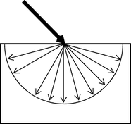
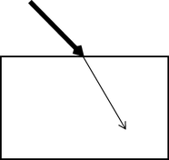
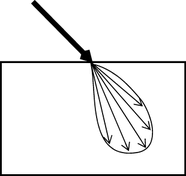

# 折射的类型

## 光线的漫反射

|  <!-- baize:img-hook downloaded=true reason="正文 134 字 <300 且带图" --> | 漫折射以许多角度散射光。 |
|---|---|

## 镜面反射折射

|  <!-- baize:img-hook downloaded=true reason="正文 134 字 <300 且带图" --> | 高光表面反射光的角度与光照射到表面的角度相同。 |
|---|---|

## 光泽折射

|  <!-- baize:img-hook downloaded=true reason="正文 134 字 <300 且带图" --> | 光泽表面实际上是高光表面，具有与表平面呈各种角度的微表面。 这些微表面不仅以高光方式折射光，还以漫反射方式折射光（角度非常接近于高光透射），从而使曲面呈现出光泽的外观。 |
|---|---|
