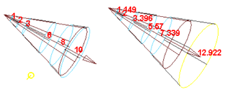

# 移动聚光灯的衰退区域

移动“衰退区域操纵器”(Decay Regions manipulators)将聚光灯的光束分离到受照明区域和不受照明的区域。*仅聚光灯包括该选项*。

请参见[以交互方式设定衰退区域](../调整衰退/以交互方式设定衰退区域.md)。

要显示该操纵器的详细信息，请参见[显示、隐藏灯光操纵器或调整其大小](../定位灯光/显示、隐藏灯光操纵器或调整其大小.md)。

 <!-- baize:img-hook downloaded=true reason="正文 131 字 <300 且带图" -->

## 相关主题

- [创建 Maya 光源](../../设置直接光源/创建光源.md)
