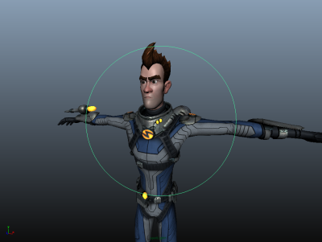

# 调整聚光灯光束

更好地查看由聚光灯照明的区域

1. 在场景或“大纲视图”(Outliner)中选择聚光灯。

2. 从[面板菜单](https://beehive.autodesk.com/community/service/rest/cloudhelp/resource/cloudhelpchannel/guidcrossbook/jsonp?v=2022&p=MAYAUL&l=CHS&accessmode=live&guid=GUID-BD5D066A-4876-4B56-8A9F-96E2243E22A3)中，选择“面板 > 沿选定对象观看”(Panels > Look Through Selected)。

   <!-- baize:img-hook downloaded=true reason="正文 292 字 <300 且带图" -->

  这表示从聚光灯角度看到的视图，绿色圆圈表示灯光圆锥体边界。超出该圆圈的对象都不能被该聚光灯照亮。

  摄影机平移、翻滚或推拉非常适合在该视图中使用，以帮助将聚光灯准确照射到所需的区域。

调整聚光灯光束的位置和角度

除了移动灯光（[定位灯光](../定位灯光.md)）和调整灯光参数（[调整光源属性](../../设置直接光源/调整光源属性.md)）之外，还可以使用以下方式调整聚光灯：

- [移动聚光灯的圆锥体半径](调整聚光灯的圆锥体角度.md)

- [移动聚光灯的衰退区域](移动聚光灯的衰退区域.md)

- [移动聚光灯的半影半径](调整聚光灯的半影角度.md)

- [移动聚光灯的挡光板（快门）](移动聚光灯的挡光板（快门）.md)

## 相关主题

- [设置直接光源](../../设置直接光源.md)
