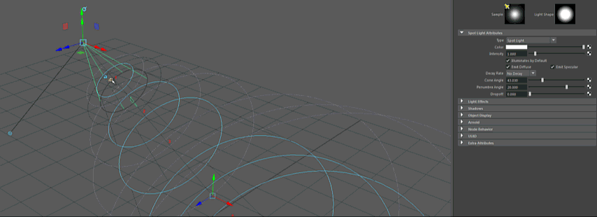

# 调整聚光灯的圆锥体角度

调整圆锥体半径操纵器以更改聚光灯光线的角度。*仅聚光灯包含此选项*。

若要显示操纵器，请参见“显示 > 显示 > 灯光操纵器”(Display > Show > Light Manipulators)。请参见[显示、隐藏灯光操纵器或调整其大小](../定位灯光/显示、隐藏灯光操纵器或调整其大小.md)。

如果在“首选项”(Preferences)窗口中已启用“显示半影的衰退区域”(Show Decay Regions for Penumbra)选项，则圆锥体角度将以实线显示，而半影区域以虚线显示。移动圆锥体半径操纵器，以交互方式调整角度。

 <!-- baize:img-hook downloaded=true reason="正文 241 字 <300 且带图" -->

## 相关主题

- [创建 Maya 光源](../../设置直接光源/创建光源.md)

- [聚光灯属性](../../照明参考/照明节点/“聚光灯”%28Spot%20Light%29选项.md)
