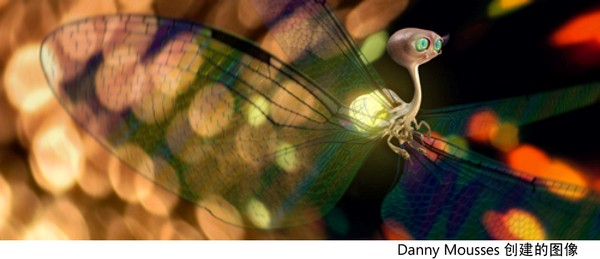

# 着色

 <!-- baize:img-hook downloaded=true reason="正文 276 字 <300 且带图" -->

在现实世界中，确定曲面外观的两个主要因素是：对象的材质和灯光。当灯光照射到对象时，一些灯光会被吸收，一些灯光会被反射。对象越平滑，则越有光泽；对象越粗糙，则越越暗淡。

在 Maya中，曲面的外观由其着色方式定义。曲面着色是对象的基本材质和应用于它的任何纹理的组合。

在 Maya中，材质（也称为着色器）定义对象的基质。材质的某些最基本属性包括颜色、透明度和光泽。有关详细信息，请参见 [Maya 材质](https://help.autodesk.com/cloudhelp/2022/CHS/Maya-LightingShading/files/GUID-E985864A-133C-47E6-B989-890EDB920D9F.htm)。

基本颜色、透明度和光泽之外的确定对象曲面外观的因素（如更复杂的颜色、透明度、光泽、曲面起伏、反射或大气）由纹理定义。请参见[纹理](着色/关于着色和纹理曲面/纹理.md)、[2D 和 3D 纹理](着色/关于着色和纹理曲面/纹理/2D%20和%203D%20纹理.md)、[程序纹理](着色/关于着色和纹理曲面/纹理/程序纹理.md)和[文件纹理](着色/关于着色和纹理曲面/纹理/文件纹理.md)。
