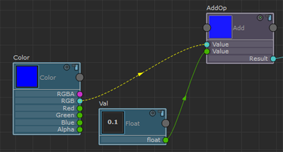
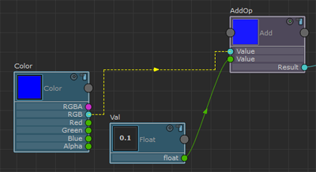

# 自定义图形的外观

## 自定义连接线

在 ShaderFX 编辑器中，可以在将连接线绘制为实线或虚线之间切换。使用不同样式的连接线有助于组织较大的节点网络。

选择一条连接线并单击鼠标右键 ( <!-- baize:img-hook downloaded=true reason="正文 254 字 <300 且带图" -->) 显示标记菜单，然后选择“工具 > 切换连接绘制样式”(Tools > Toggle Connection Draw Style)。

 <!-- baize:img-hook downloaded=true reason="正文 254 字 <300 且带图" -->

也可以将连接线绘制为其他样式。按下  <!-- baize:img-hook downloaded=true reason="正文 254 字 <300 且带图" -->+ <!-- baize:img-hook downloaded=true reason="正文 254 字 <300 且带图" --> 并拖动连接线以创建外观不同的连接线。

 <!-- baize:img-hook downloaded=true reason="正文 254 字 <300 且带图" -->

### 还原为默认值

若要将自定义线样式还原为默认值，请选择该线，单击鼠标右键 ( <!-- baize:img-hook downloaded=true reason="正文 254 字 <300 且带图" -->) 以显示标记菜单，然后选择“工具 > 重置连接”(Tools > Reset Connection)。
