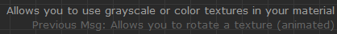
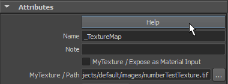
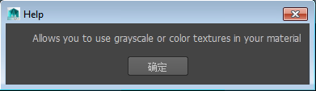

# 针对各个节点类型查找帮助

从[标记菜单](ShaderFX%20标记菜单.md)中选择节点时，ShaderFX 窗口将在工作区域的右下角显示一个工具提示。

 <!-- baize:img-hook downloaded=true reason="正文 137 字 <300 且带图" -->

您稍后可以显示相同的文本，方法是：单击某节点以将其高亮显示，然后单击节点“属性编辑器”(Attribute Editor)中的“帮助”(Help)按钮：

 <!-- baize:img-hook downloaded=true reason="正文 137 字 <300 且带图" -->

这将打开一个对话框，其中也会显示工具提示：

 <!-- baize:img-hook downloaded=true reason="正文 137 字 <300 且带图" -->
