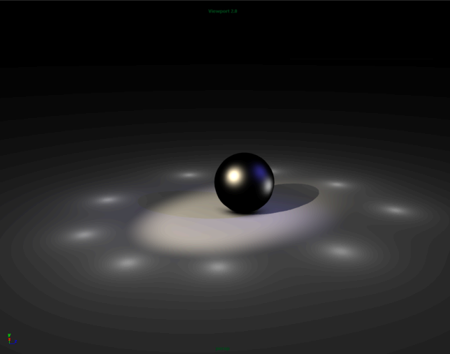

# ShaderFX 组示例工作流

在此场景中是一个应用了“ShaderFX”着色器的球体。

若要创建“ShaderFX”着色器，请在对象上单击鼠标右键 ( <!-- baize:img-hook downloaded=true reason="正文 242 字 <300 且带图" -->)，选择“指定新材质”(Assign New Material)，然后从“指定新材质”(Assign New Material)窗口中选择“Shaderfx 着色器”(Shaderfx Shader)。

在 ShaderfxShader 的“属性编辑器”(Attribute Editor)中，单击“打开 ShaderFX”(Open ShaderFX)，以编辑“ShaderFX”节点图表。

 <!-- baize:img-hook downloaded=true reason="正文 242 字 <300 且带图" -->
