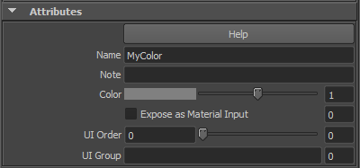
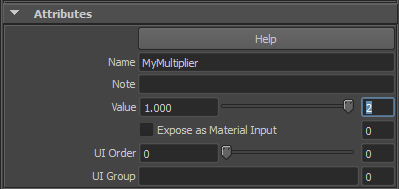
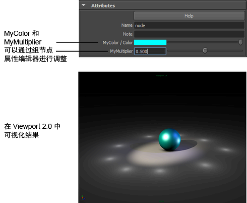

# 在组节点“属性编辑器”(Attribute Editor)中显示组成员

您的组包含多个节点。在组节点“属性编辑器”(Attribute Editor)中将这些节点显示为属性，以便无需进入组视图就可以调整节点值。

1. 在组视图中选择“颜色”(Color)节点。

2. 进入“名称”字段 (MyColor) 并为其指定一个顺序编号 (1)。

   <!-- baize:img-hook downloaded=true reason="正文 261 字 <300 且带图" -->

3. 使用 MyMultiplier 和顺序编号 2，为“浮点”(Float)节点重复相同的操作。

   <!-- baize:img-hook downloaded=true reason="正文 261 字 <300 且带图" -->

4. 退出组视图，并选择相应的组节点。组节点的“属性编辑器”(Attribute Editor)现在将 MyColor 和 MyMultiplier 显示为属性。

  现在，您可以调整颜色和倍增，并且无需进入组视图。

   <!-- baize:img-hook downloaded=true reason="正文 261 字 <300 且带图" -->
