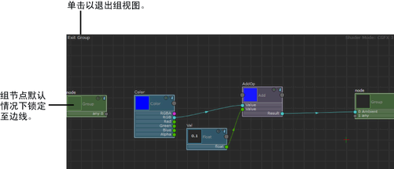

# 可视化组的内容

可视化组内容

1. 单击节点顶部的“组”(Group)  <!-- baize:img-hook downloaded=true reason="正文 158 字 <300 且带图" -->图标可以可视化其组网络。

  若要返回到主节点网络，请单击“ShaderFX”编辑器左上角的“退出组”(Exit Group)。

 <!-- baize:img-hook downloaded=true reason="正文 158 字 <300 且带图" -->

**注**

默认情况下，会将组节点锁定到

“ShaderFX”

编辑器的四周。要自定义其位置并移动节点，请禁用

Settings > Lock Group to Sides

。
