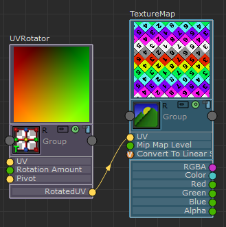

# 可视化已设置动画的着色器

可以在“ShaderFX”编辑器中可视化已设置动画的着色器的动画，例如，“UVRotator”(Hw Shader Nodes > Textures > UV Rotator)。

1. 单击“渲染样例”(Render Swatch)图标，以便显示较小或较大的渲染样例。

2. 选择 Settings > Play Animated Shaders 可以可视化已设置动画的着色器及其下游节点的动画。

 <!-- baize:img-hook downloaded=true reason="正文 237 字 <300 且带图" -->

**注**

也可以按 Maya 播放控件中的“向前播放”(Play Forwards)按钮在 Maya Viewport 2.0 中可视化动画。
