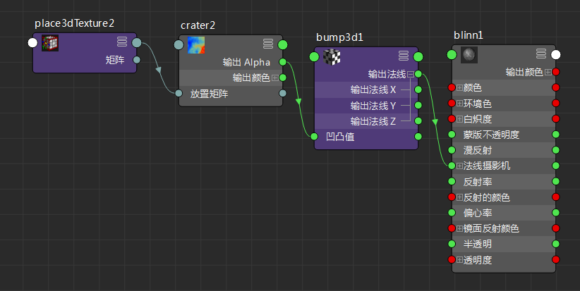
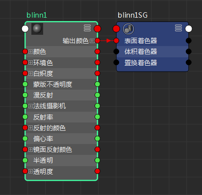
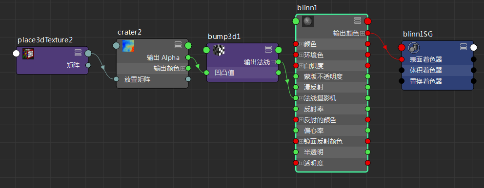

# 显示节点连接

有关渲染节点和连接的详细信息，请参见[关于着色网络](https://help.autodesk.com/cloudhelp/2022/CHS/Maya-LightingShading/files/GUID-599CACDB-76C1-4FAC-AA94-0E77F0042C8D.htm)。

显示连接

1. 选择要查看连接的节点，然后在 Hypershade 工具栏中单击以下图标之一。（将光标悬停在一个图标上以显示其名称。）

  **注**

  输入和输出连接有时称为上游/下游连接。

  #### 输入连接(Input Connections)

   <!-- baize:img-hook downloaded=true reason="正文 268 字 <300 且带图" -->

  显示选定节点的输入连接或上游连接。此选项绘制网络直至选定节点的输入。

   <!-- baize:img-hook downloaded=true reason="正文 268 字 <300 且带图" -->

  #### 输出连接(Output Connections)

   <!-- baize:img-hook downloaded=true reason="正文 268 字 <300 且带图" -->

  显示选定节点的输出连接或下游连接。此选项从选定节点的输出绘制网络。

   <!-- baize:img-hook downloaded=true reason="正文 268 字 <300 且带图" -->

  #### 输入和输出连接(Input and Output Connections)

   <!-- baize:img-hook downloaded=true reason="正文 268 字 <300 且带图" -->

  显示选定节点的输入和输出连接。

   <!-- baize:img-hook downloaded=true reason="正文 268 字 <300 且带图" -->
