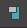

# 在 Lookdev 视图和属性编辑器之间切换

## 在 Lookdev 视图和属性编辑器之间切换

通过单击特性编辑器顶部的  <!-- baize:img-hook downloaded=true reason="正文 126 字 <300 且带图" -->，可以在 Lookdev 模板视图中显示着色节点属性或在经典属性编辑器视图中显示它们之间进行切换。

## 撕下特性编辑器

通过单击  <!-- baize:img-hook downloaded=true reason="正文 126 字 <300 且带图" -->，可以在单独的浮动窗口中获取特性编辑器。可以获取多个浮动特性编辑器窗口。
