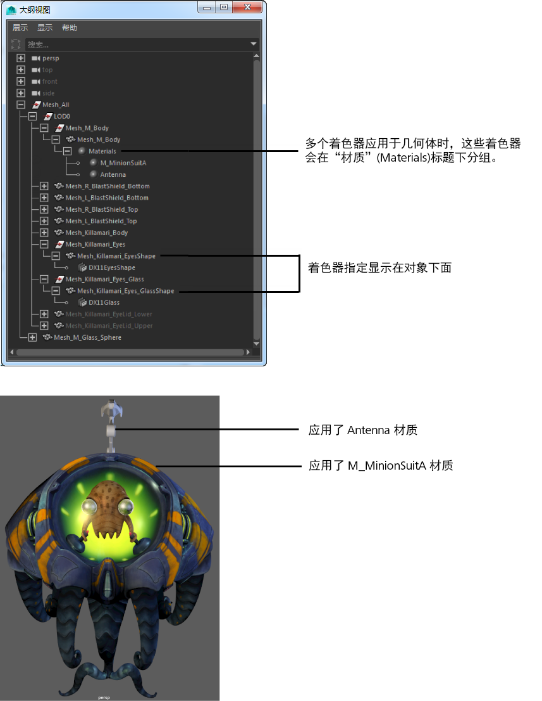

# 标识指定给场景中每个对象的着色器

通过在[大纲视图(Outliner)](https://beehive.autodesk.com/community/service/rest/cloudhelp/resource/cloudhelpchannel/guidcrossbook/jsonp?v=2022&p=MAYAUL&l=CHS&accessmode=live&guid=GUID-4B9A9A3A-83C5-445A-95D5-64104BC47406)中启用“显示 > 指定的材质”(Display > Assigned Materials)选项，显示指定给场景中每个对象的着色器。

如果对象涉及逐面着色器指定，则会将指定给对象的所有着色器列入并分组到“材质”(Materials)标题下。

 <!-- baize:img-hook downloaded=true reason="正文 130 字 <300 且带图" -->
