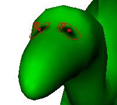

# 反射所绘制内容

可以沿任何轴反射您绘制的笔划，以便在绘制时该笔划镜像到轴的相对一侧。该反射轴基于所选内容边界框的中心。“反射”(Reflection)可用于创建对称效果。

 <!-- baize:img-hook downloaded=true reason="正文 183 字 <300 且带图" -->

反射所绘制内容

1. 打开“笔划”(Stroke)部分，然后选择反射轴，例如 X、Y、Z 或它们的任意组合。请注意，随后曲面上出现两个、四个或六个笔刷轮廓，具体取决于所选的轴数。

2. 绘制曲面。已绘制的笔划会通过选定的轴进行反射。
