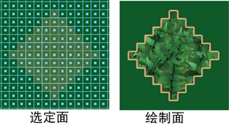

# 在多边形上限制绘制区域

在多边形上绘制时，您可以仅绘制选定面，封锁其余的面并防止对它们进行绘制。也可以使用绘制整体应用您的选择（请参见[整体应用选定的多边形面](https://help.autodesk.com/cloudhelp/2022/CHS/Maya-LightingShading/files/GUID-0E4D94A5-E453-4FA9-9B10-ADC63A20DB0C.htm#WS17956D7ADBC6E736-7797D69C117AE32D751-7FF6)）。

 <!-- baize:img-hook downloaded=true reason="正文 288 字 <300 且带图" -->

仅绘制选定的多边形面

1. 选择要绘制的面。必须已经为曲面指定了纹理。

2. 选择“3D 绘制工具”(3D Paint Tool)。选定面周围将显示一个轮廓。

3. 选择笔刷并在选定面上绘制。如果使用“Paint Effects”笔刷绘制，必须启用“屏幕投影”(Screen Projection)。

  如果笔划延伸到未选定的面，未选定的面将不受影响。

  **注**

  若要更改您的选择，必须退出

  “3D 绘制工具”(3D Paint Tool)

  ，做出新的选择，然后重新进入该工具。无需重新指定纹理。
