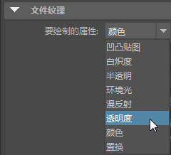
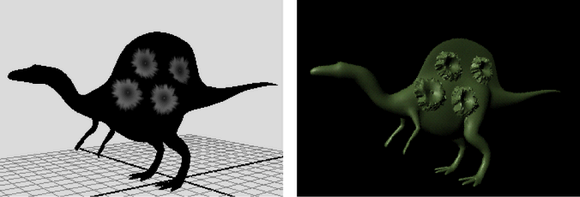

# 绘制纹理列表中未显示的属性

在 3D 绘制工具设置中，“文件纹理”(File Textures)部分显示当前纹理的可绘制属性列表：

 <!-- baize:img-hook downloaded=true reason="正文 192 字 <300 且带图" -->

如果要绘制列表中未显示的属性（例如，Blinn 材质的“偏心率”(Eccentricity)），则可先在列表中的单个通道（灰度）属性上绘制，然后使用 Hypershade 将该纹理连接到列表中未列出的着色器属性。有关详细信息，请参见 [3D 绘制工具设置](https://help.autodesk.com/cloudhelp/2022/CHS/Maya-LightingShading/files/GUID-11EAC728-8E0A-46F6-A0D8-A68E3D60DD13.htm)中的[文件纹理(File Textures)部分](https://help.autodesk.com/cloudhelp/2022/CHS/Maya-LightingShading/files/GUID-11EAC728-8E0A-46F6-A0D8-A68E3D60DD13.htm#GUID-11EAC728-8E0A-46F6-A0D8-A68E3D60DD13__WS1A9193826455F5FF-6381D1FC11809382DB8-7ECA)。

 <!-- baize:img-hook downloaded=true reason="正文 192 字 <300 且带图" -->
