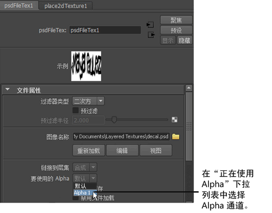

# 在场景视图中显示 PSD 文件的 Alpha

如果 PSD 文件包含 Alpha 通道，必须遵循以下步骤以在 Maya 中显示 Alpha（例如，场景视图、交互式渲染器和渲染）。

1. 在 PSD 文件节点中，默认情况下属性“要使用的 Alpha”(Alpha In Use)设定为“默认”(Default)。默认情况下，这将忽略 Alpha 通道。

2. 作为替代，选择“要使用的 Alpha”(Alpha In Use)下拉列表中的 Alpha 通道。现在，应该能够在场景视图中查看 Alpha。

   <!-- baize:img-hook downloaded=true reason="正文 199 字 <300 且带图" -->
