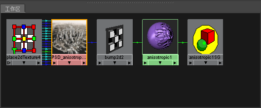
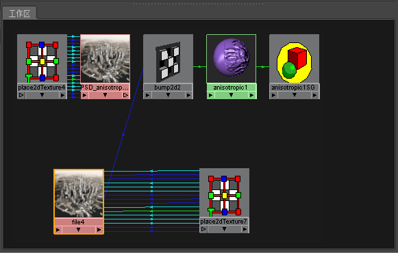

# 将 PSD 节点转化为文件纹理

您可以在 Maya 中将 PSD 节点自动转化为文件纹理。绘制完成后，可以轻松将着色网络中的大型 PSD 文件替换为小型文件纹理。

将 PSD 节点转化为文件纹理

1. 在 Hypershade 中，选择 PSD 节点（在我们的示例中为 PSD_anisotropic1）。

   <!-- baize:img-hook downloaded=true reason="正文 232 字 <300 且带图" -->

2. 在“Hypershade”菜单中选择[编辑 > 将 PSD 转化为文件纹理(Edit > Convert PSD to File Texture)](https://help.autodesk.com/cloudhelp/2022/CHS/Maya-LightingShading/files/GUID-EF6DFB31-CFCF-428D-8961-3D96CE673F99.htm#GUID-EF6DFB31-CFCF-428D-8961-3D96CE673F99__GUID-579E2F56-44C7-49D1-B75E-8FD241528C61)（Maya 软件）。

  将自动创建文件纹理节点。新文件纹理节点将替换网络中的 PSD 文件，同时保持之前的连接。

   <!-- baize:img-hook downloaded=true reason="正文 232 字 <300 且带图" -->
