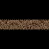

# 文件纹理

文件纹理是位图图像，其过滤效果比大部分程序纹理好，并且可以得到更好的图像质量。

**注**

出于下列目的，您可以渲染着色网络的整个分支以将照明、阴影、着色和纹理用作文件纹理（纹理贴图）：

- 缩短当网络特别复杂时或者当全局照明功能错综复杂时的渲染时间。

- 获得以其他方式很难实现的照明效果。

详细信息请参见[烘焙照明和颜色](https://help.autodesk.com/cloudhelp/2022/CHS/Maya-LightingShading/files/GUID-F68686B3-965D-412A-87BA-CFAC81905ED9.htm)。

## 方形和非方形位图图像

您希望您的纹理与模型完美适配，就仿佛纹理已绘制到模型上一样。您可以调节纹理附加到的曲面。不过，如果 Maya 能够将任何非方形纹理缩放为方形纹理，Maya LT 会更高效，因此，建议首先使用方形图像。如果您正在为其绘制纹理的对象不是方形的（例如，灯杆），请将纹理置于一个黑色方形中。

 <!-- baize:img-hook downloaded=true reason="正文 297 字 <300 且带图" -->
