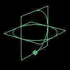

# 使用“环境球体”(Env Sphere)模拟反射

有关该纹理的详细信息，请参见[环境球体(Env Sphere)](https://help.autodesk.com/cloudhelp/2022/CHS/Maya-LightingShading/files/GUID-1FF8EE4D-DEAF-4E6C-895C-D2E6EB670BAA.htm)。

使用“球体”(Sphere)纹理放置对象

1. “球体”(Sphere)环境纹理提供了用于调整曲面上纹理的纹理放置对象。使用 Maya 的变换工具可以缩放、移动或旋转纹理放置对象。

   <!-- baize:img-hook downloaded=true reason="正文 239 字 <300 且带图" -->

此外，还可以交互放置纹理或者使其适合对象。可以选择提供特殊操纵器的“交互式放置”(Interactive Placement)，也可以从“球体”(Sphere)的 place3dTexture 属性中选择“适配到组边界框”(Fit to group bbox)。
