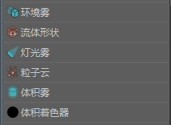

# 体积材质

## 体积材质概述

 <!-- baize:img-hook downloaded=true reason="正文 249 字 <300 且带图" -->

从 Hypershade [“创建”(Create)选项卡](../../着色窗口和编辑器/Hypershade%20窗口/“创建”%28Create%29选项卡.md)和“创建渲染节点”(Create Render Node)窗口中，可以创建“表面材质”(Surface Materials)、“体积材质”(Volumetric Materials)和“置换材质”(Displacement Materials)。有关体积材质的详细信息，请参见 [Maya 材质](../../../关于着色和纹理曲面/将颜色和着色应用于对象/Maya%20材质.md)。

- 某些属性（例如“蒙版不透明度”(Matte Opacity)）为所有体积材质所共有，[公用体积材质属性](https://help.autodesk.com/cloudhelp/2022/CHS/Maya-LightingShading/files/GUID-B24E91A8-36B6-4899-B162-516DBB5515DC.htm)中描述了这些属性。

- 材质名称下提供了特定于体积材质的描述。
