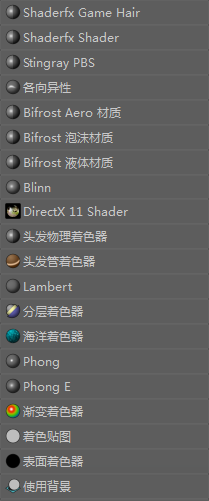

# 表面材质

 <!-- baize:img-hook downloaded=true reason="正文 273 字 <300 且带图" -->

从 Hypershade [“创建”(Create)选项卡](../../着色窗口和编辑器/Hypershade%20窗口/“创建”%28Create%29选项卡.md) 和“创建渲染节点”(Create Render Node)窗口中，可以创建“表面”(Surface)材质、“体积”(Volumetric)材质和“置换”(Displacement)材质。有关表面材质的详细信息，请参见 [Maya 表面材质](../../../关于着色和纹理曲面/将颜色和着色应用于对象/Maya%20材质.md)。

某些属性（如颜色和透明度）对于大多数表面材质是公用的，在[公用表面材质属性](https://help.autodesk.com/cloudhelp/2022/CHS/Maya-LightingShading/files/GUID-AEA3C15F-1C08-44CF-9CBF-C9E90CC0F09E.htm)中进行了描述。

某些属性是许多表面材质之间共享的，因此与“公用”(Common)表面属性分开单独进行分组，这些属性在[共享的表面材质区域](https://help.autodesk.com/cloudhelp/2022/CHS/Maya-LightingShading/files/GUID-426A7F26-4647-4DC4-B390-6380620AD757.htm)中进行了描述。

此部分的材质名称下提供了特定于表面材质的描述。
