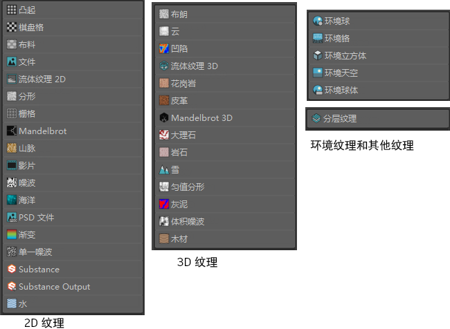

# 纹理节点概述

 <!-- baize:img-hook downloaded=true reason="正文 250 字 <300 且带图" -->

从 Hypershade [“创建”(Create)选项卡](https://help.autodesk.com/cloudhelp/2022/CHS/Maya-LightingShading/files/GUID-76B10C8D-EC19-4AFE-8433-743326C49DBE.htm)和“创建渲染节点”(Create Render Node)窗口中，可以创建“2D 纹理”(2D textures)、“3D 纹理”(3D textures)、“环境纹理”(Env(ironment) textures)和“其他纹理”(Other textures)（“分层纹理”(Layered Texture)）。

某些属性可在多种曲面材质之间共享，因而可以单独分组，如下所述：

- [共享 2D 纹理属性](纹理节点概述/2D%20纹理/共享%202D%20纹理属性.md)。

- [共享 3D 纹理属性](纹理节点概述/3D%20纹理/共享%203D%20纹理属性.md)。

有关纹理特定的属性的信息，请参见 2D 或 3D 纹理名称。
