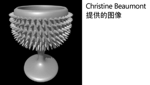

# 表面起伏

表面起伏是对象的表面中的洼地（低起伏）和高地（高起伏）。示例包括山峰、山谷和行星的高原或高尔夫球的凹坑。

尽管可以将表面起伏建模到对象的几何体中，但通常使用用作凹凸贴图（它会创建起伏的效果）或置换贴图（它会通过更改对象的拓扑创建真实的表面起伏）的纹理获得同样的外观会更快、更容易。

 <!-- baize:img-hook downloaded=true reason="正文 139 字 <300 且带图" -->
