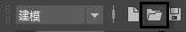

# 打开最近保存的文件

要打开最近保存的 Maya 场景文件，请执行下列操作之一：

- 选择“文件 > 最近的文件”(File > Recent Files)，然后从显示的列表中选择所需的文件。

- 在[状态行（工具栏）](https://beehive.autodesk.com/community/service/rest/cloudhelp/resource/cloudhelpchannel/guidcrossbook/jsonp?v=2022&p=MAYAUL&l=CHS&accessmode=live&guid=GUID-86E5CEDA-4100-40AE-8F95-346206CF8456)的“打开场景”(Open a Scene)图标上单击鼠标右键，然后选择文件。

   <!-- baize:img-hook downloaded=true reason="正文 227 字 <300 且带图" -->

  **注**

  您可以使用

  “文件/项目”(Files/Projects)首选项

  （

  “窗口 > 设置/首选项 > 首选项”(Window > Settings/Preferences > Preferences)

  ）自定义在此列表中显示的文件数量。
