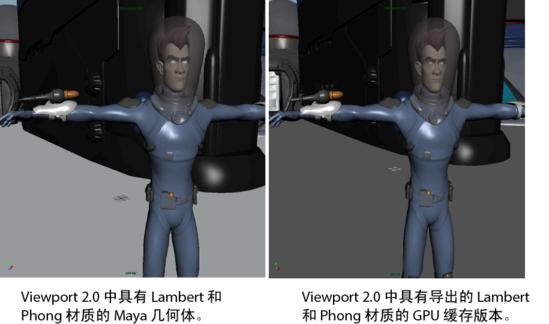

# 对 GPU 缓存进行着色和渲染

创建 GPU 缓存文件时，原始几何体的 Lambert 和 Phong 材质可随缓存对象一起保存。当缓存在 Viewport 2.0 中播放时，这些材质将得到渲染。

 <!-- baize:img-hook downloaded=true reason="正文 193 字 <300 且带图" -->

您也可以导出原始对象的颜色信息，包括烘焙漫反射颜色数据。如果原始对象包括纹理，则不导出颜色信息。源对象的纹理和材质将被默认着色颜色替换。

请参见[创建或导入 GPU 缓存](创建或导入%20GPU%20缓存.md)。

## 相关主题

- [递归 GPU 缓存](递归%20GPU%20缓存.md)

- [创建或导入 GPU 缓存](创建或导入%20GPU%20缓存.md)

- [使用 MEL 命令保存和加载流水线缓存](../使用%20MEL%20命令保存和加载流水线缓存.md)
