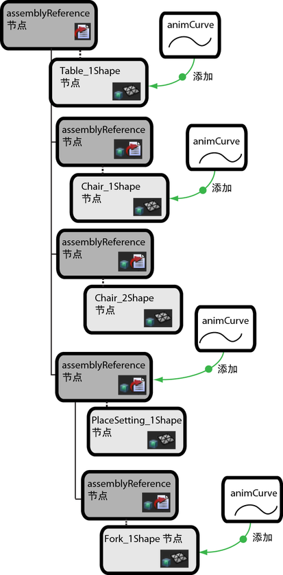

# 将动画曲线添加到场景集合节点

可以将动画曲线数据添加到 assemblyReference 节点和场景表示包含的节点。可以对集合引用层次的所有级别节点进行这些连接。最高级别的集合引用节点可存储及跟踪将动画曲线连接到节点的编辑。动画曲线数据驻留在 assemblyReference 节点或场景表示的源文件中。

下图显示了有关可能的动画曲线连接的示例。

 <!-- baize:img-hook downloaded=true reason="正文 198 字 <300 且带图" -->

## 相关主题

- [场景集合编辑](../场景集合编辑.md)

- [在场景集合节点之间建立属性连接](在场景集合节点之间建立属性连接.md)

- [列出场景集合编辑](列出场景集合编辑.md)

- [使用场景集合构建场景](../使用场景集合构建场景.md)
