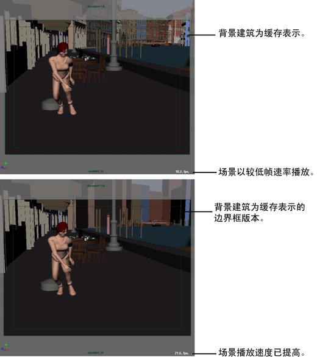

# 将边界框对象用作表示

您可以将场景中的复杂对象转化为边界框，然后将这些对象用作简单的预可视化场景或缓存表示。使用边界框设置场景还可提高播放速度并减少内存使用。例如，可以在完整城市场景的上下文中直接为某个角色调整关键帧动画。

请参见[修改 > 转化 > 几何体到边界框(Modify > Convert > Geometry to Bounding Box)](https://beehive.autodesk.com/community/service/rest/cloudhelp/resource/cloudhelpchannel/guidcrossbook/jsonp?v=2022&p=MAYAUL&l=CHS&accessmode=live&guid=GUID-66D4B6EA-D0E0-4BFB-B8A7-4EE42FF3F128)。

 <!-- baize:img-hook downloaded=true reason="正文 181 字 <300 且带图" -->

## 相关主题

- [集合表示](../场景集合基础知识/集合表示.md)

- [集合定义](../场景集合基础知识/集合定义.md)

- [集合引用](../场景集合基础知识/集合引用.md)

- [使用场景集合构建场景](../使用场景集合构建场景.md)
