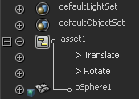

# 查看已发布的属性

可以像查看其他节点的属性那样，采用同样的方式在“大纲视图”(Outliner)中查看资产属性。但是，您还可以将“大纲视图”(Outliner)限于仅显示已发布的属性。

在大纲视图中查看已发布的属性

1. 在“大纲视图”(Outliner)中，选择“显示 > 属性(通道)”(Display > Attributes (Channels))。

  所有节点都会立即展开，以显示其属性。

2. 选择“显示 > 属性 > 已发布”(Show > Attributes > Published)。

 <!-- baize:img-hook downloaded=true reason="正文 284 字 <300 且带图" -->

现在，如果展开某个节点来查看其属性，您*只能*看到已发布的属性。这适用于资产节点及其内部节点。未被资产封装的节点根本不会显示任何属性。
