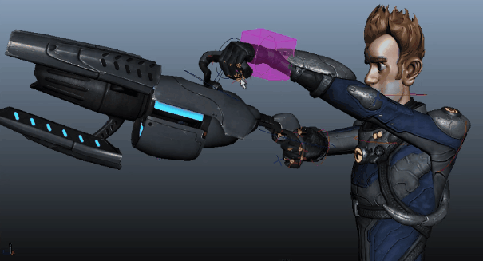

# HumanIK 中的循环约束

 <!-- baize:img-hook downloaded=true reason="正文 194 字 <300 且带图" -->

将道具连接到 HIK 装备时，可以使用约束将道具连接到一个效应器，然后将该受约束对象用作第二个约束的源。例如，您可以连接受右手驱动的道具，然后使该道具驱动左侧的辅助效应器。

1. 选择 IK 或 FK 效应器，并创建一个约束（父、点、方向或目标）以将该效应器作为源对象连接到目标道具。

2. 创建将该道具（源）连接到另一个对象（例如辅助效应器）的第二个约束。

**注**

当循环约束处于活动状态时，IK 拉动无法用于 HIK 装备。
