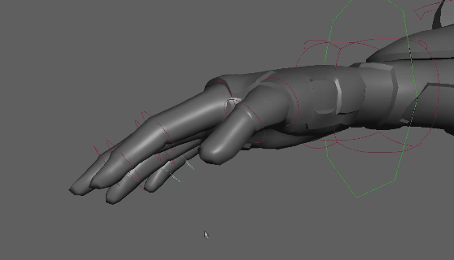

# 定义自定义拾取漫游层次

您可以设置自定义控制器层次，以便在复杂的装备结构中拾取漫游。

 <!-- baize:img-hook downloaded=true reason="正文 273 字 <300 且带图" -->

若要使节点可拾取，必须将其设置为控制器：

1. 在拾取漫游层次中，选择要定义为父对象的对象。

2. 在[“控制”(Control)菜单](https://help.autodesk.com/cloudhelp/2022/CHS/Maya-CharacterAnimation/files/GUID-2F969346-12B7-4DD3-BD6C-053C23823F5B.htm)中，选择“父控制器”(Parent Controller)。还可以在命令行中输入 **controller -p** 命令，以便在[依存关系图](https://beehive.autodesk.com/community/service/rest/cloudhelp/resource/cloudhelpchannel/guidcrossbook/jsonp?v=2022&p=MAYAUL&l=CHS&accessmode=live&guid=GUID-51096BC4-32B7-4391-BE39-21641B374745)中创建新的控制器对象。有关此命令以及其他控制器命令的信息，请参见技术文档。

3. 使用上下左右箭头键可以在层次中移动。在[控制器标记属性](https://help.autodesk.com/cloudhelp/2022/CHS/Maya-CharacterAnimation/files/GUID-17AF3B37-8A57-46DD-8808-D4BFF23AD285.htm)中设置“循环行走同级项”(Cycle Walk Sibling)以设置拾取漫游选择循环。

## 相关主题

- [控制器节点](https://beehive.autodesk.com/community/service/rest/cloudhelp/resource/cloudhelpchannel/guidcrossbook/jsonp?v=2022&p=MAYAUL&l=CHS&accessmode=live&guid=GUID-21B83FF0-0435-4087-8C2E-23B420028B71#GUID-21B83FF0-0435-4087-8C2E-23B420028B71__SECTION_CAB2606CDAEB440E9E251C7AC98F8EB3)

- [将对象标记为控制器](https://help.autodesk.com/cloudhelp/2022/CHS/Maya-CharacterAnimation/files/GUID-17AF3B37-8A57-46DD-8808-D4BFF23AD285.htm)
