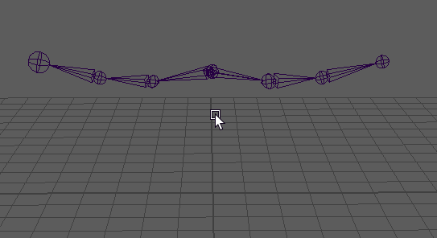

# 断开对称连接

断开对称连接

创建对称的关节后，通过移除对称连接，可以单独修改每个关节。

1. 选择源关节并执行以下操作之一：

  - 单击鼠标右键，然后从标记菜单中选择“破坏对称性”(Break Symmetry)。

  - 从主菜单中选择“按类型删除 > 约束”(Delete by Type > Constraints)。

  此时对称连接已断开。

  **注**

  若要破坏整个层级上的

  所有

  对称连接，请在根关节上单击鼠标右键，然后从关节标记菜单中选择

  “层级”(Hierarchy)

  ，然后再选择

  “破坏对称性”(Break Symmetry)

  。

   <!-- baize:img-hook downloaded=true reason="正文 294 字 <300 且带图" -->

  若要破坏关节链上的对称，请单击鼠标右键，然后选择“层级”(Hierarchy)

## 相关主题

- [关节工具(Joint Tool)标记菜单](https://help.autodesk.com/cloudhelp/2022/CHS/Maya-CharacterAnimation/files/GUID-D403B411-A712-4900-A93B-E44C670760B0.htm)
