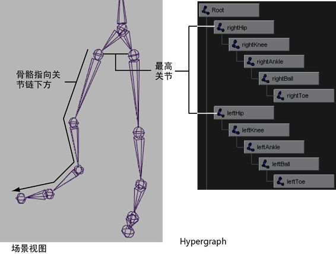

# 关节链

关节链是任何一组串联的关节及其骨骼。关节以线性方式连接，它们的路径以骨骼的形式表现在屏幕上。关节链从链层次的最高关节处开始，然后沿链向下绘制骨骼。

 <!-- baize:img-hook downloaded=true reason="正文 153 字 <300 且带图" -->

创建关节链时，各个关节的位置应与您尝试创建的角色关节的解剖位置近似。例如，如果您正在创建两足动物骨架模型关节链，应将关节放在关节连接点处，如肘部、膝盖、脚踝等。
