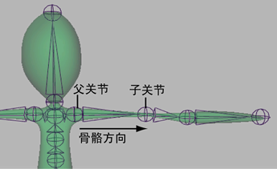
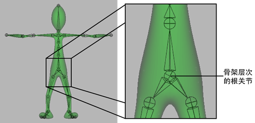

# 骨架层次

骨架层次由一系列具有层次关系的关节和关节链组成。骨架层次中的每个关节都既是子关节，也是父关节。

 <!-- baize:img-hook downloaded=true reason="正文 253 字 <300 且带图" -->

父关节是指在骨架层次中处于较高级别的关节，受其动作影响的其他任何关节则处于较低级别。在骨架层次中处于父关节下方的关节称为子关节。骨骼顶部的关节始终为父关节，而骨骼底部的关节始终为子关节。父关节驱动各自子关节的变换。因此，平移或旋转父关节时，也会同时平移或旋转其所有子关节。

根关节是骨架层次中最高级别的关节。一个骨架只能有一个根关节。可以通过平移和旋转根关节移动并确定整个骨架在世界空间中的方向。

 <!-- baize:img-hook downloaded=true reason="正文 253 字 <300 且带图" -->

## 相关主题

- [重定骨架根](../设置关节链/重定骨架根.md)
