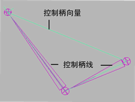

# 单链 IK 解算器

单链 IK 控制柄使用单链解算器来计算 IK 链中所有关节的旋转。另外，可以使用单链解算器直接计算关节链的整个方向。

 <!-- baize:img-hook downloaded=true reason="正文 102 字 <300 且带图" -->

## 单链 IK 控制柄组件

请参见 [IK 控制柄概述](https://help.autodesk.com/cloudhelp/2022/CHS/Maya-CharacterAnimation/files/GUID-8AFE1FEB-C69C-4841-9787-3C196FDA9A1F.htm)主题中的“常规 IK 控制柄组件”。

## 相关主题

- [创建单链 IK 控制柄](创建单链%20IK%20控制柄.md)
