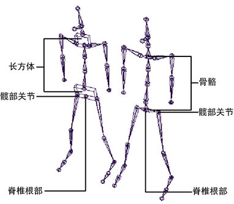

# 更改关节显示选项

根据工作流，该选项可用于为表示和可视化关节类型设置替代方法。

更改关节的显示方式

1. 选择关节。

2. 在“属性编辑器”(Attribute Editor)中，选择 joint*n* 节点选项卡。

3. 在“关节”(Joint)区域，从“绘制样式”(Draw Style)下拉列表中选择绘制选项。

  例如，您可以选择“作为外框的多子对象”(Multi-child as Box)来将具有多个子对象的关节的骨骼显示为一个框。这可能是直观表示节点（如骨盆或肩部）的有效方式。

   <!-- baize:img-hook downloaded=true reason="正文 233 字 <300 且带图" -->

  有关显示选项的详细信息，请参见[绘制样式](https://help.autodesk.com/cloudhelp/2022/CHS/Maya-CharacterAnimation/files/GUID-8CE29E9D-F1C5-42A3-A657-33E32887380A.htm#WS73099CC142F48755-3D114B7511841AEFA9F214B)。
