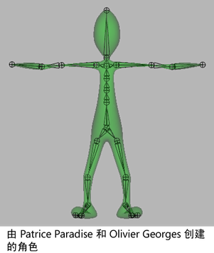

# 骨架

骨架是分层的有关节的结构，用于设定绑定模型的姿势和对绑定模型设置动画。骨架提供了一个可变形模型，其基础结构与人类骨架提供给人体的基础结构相同。

 <!-- baize:img-hook downloaded=true reason="正文 139 字 <300 且带图" -->

就像在人体中一样，添加到骨架的关节的位置和关节的数量确定骨架的绑定模型或“身体”会如何移动。将模型绑定到骨架时，它称为蒙皮。

## 相关主题

- [蒙皮](https://help.autodesk.com/cloudhelp/2022/CHS/Maya-CharacterAnimation/files/GUID-66922B35-A848-4161-BFCF-4EB75413702E.htm)
