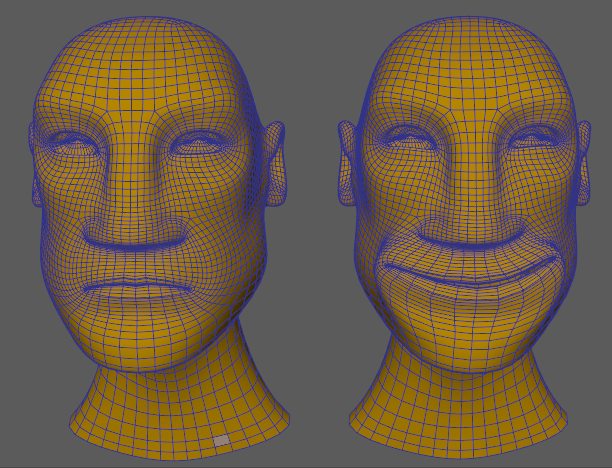

# 变形变形器

 <!-- baize:img-hook downloaded=true reason="正文 186 字 <300 且带图" -->

“变形”(Morph)变形器用于将一个几何体的变形应用到另一个几何体，这与[“融合变形”(Blend Shape)变形器](https://help.autodesk.com/cloudhelp/2022/CHS/Maya-CharacterAnimation/files/GUID-7413C450-603C-4EAD-AF70-465D4EAE5973.htm)类似，但启用 [GPU 加速](使用变形器/支持%20GPU%20的变形器.md)，并可以将旧版 CPU 变形器合并到变形链中，而不会阻止对链的其余部分进行 GPU 解算。

您甚至可以使用“变形”(Morph)变形器快速重定动画目标或镜像几何体。

 <!-- baize:img-hook downloaded=true reason="正文 186 字 <300 且带图" -->

“变形”(Morph)变形器将添加到左侧的头部，因此它可以采用右侧头部的表达式。
