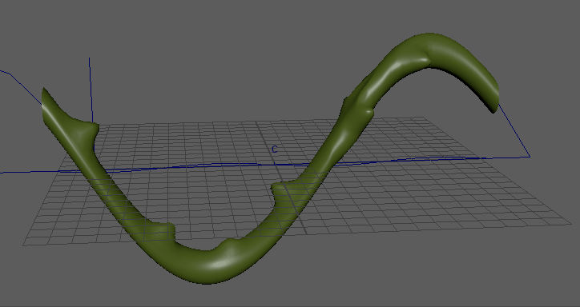

# 固化变形器

 <!-- baize:img-hook downloaded=true reason="正文 198 字 <300 且带图" -->

 <!-- baize:img-hook downloaded=true reason="正文 198 字 <300 且带图" -->

当要保持几何体的变形区域为实体（或非变形）时，请使用“固化”(Solidify)变形器。如果要在变形龙尾部上创建实心钉形，或者对于装备的刚性部件（例如建模为角色变形衣服的一部分的皮带扣），该功能可能很有用。

“固化”(Solidify)变形器分析变形的截面，并将其分成单独的多边形孤岛，让几何体各截面的外观变得更坚实、拉伸更少。

通过将每个多边形孤岛替换为移动并融合到位的[原始几何体](变形器成员身份/使用组件标记编辑变形器成员身份/原始几何体.md)，可以实现此效果。
