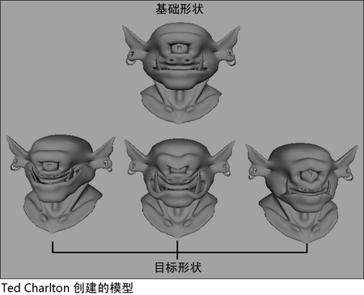
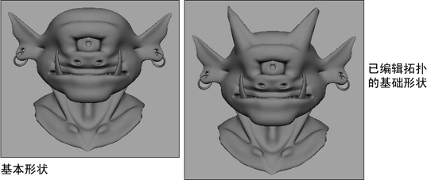
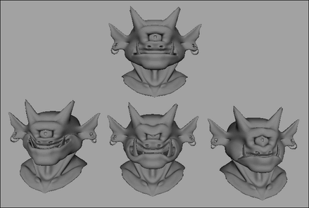

# 将拓扑更改从基础对象传播到目标对象

您可以更改基础对象的拓扑，然后将这些更改传播到与该基础对象关联的所有目标对象。

 <!-- baize:img-hook downloaded=true reason="正文 196 字 <300 且带图" -->

传播基础对象拓扑更改

1. 对基础对象的几何体进行拓扑更改（例如，将其变形）。

   <!-- baize:img-hook downloaded=true reason="正文 196 字 <300 且带图" -->

2. 选定基础对象后，选择“变形器 > (编辑) 融合变形”(Deformers > (Edit) Blend Shape) > [将拓扑烘焙到目标(Bake Topology To Targets)](../变形器参考/“变形”%28Deform%29菜单/“融合变形”%28Blend%20Shape%29菜单/融合变形%20将拓扑烘焙到目标%28Blend%20Shape%20Bake%20Topology%20To%20Targets%29.md)。

  相关目标对象的拓扑将更新以反映其基础对象的拓扑，并烘焙基础对象的建模历史。

   <!-- baize:img-hook downloaded=true reason="正文 196 字 <300 且带图" -->
