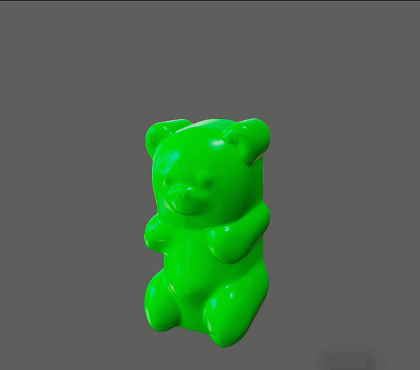

# 抖动变形器

抖动变形器允许您使曲面或曲线上的点在移动、加速或减速时振动。

 <!-- baize:img-hook downloaded=true reason="正文 239 字 <300 且带图" -->

抖动变形器模拟橡皮糖熊的凝胶状振动

例如，可以创建各种效果，如：

- 摔跤选手的腹部抖动

- 头发抖动

- 一只昆虫的触须振动

可以将抖动应用到特定点或整个对象。在抖动变形器的上下文中，术语点意味着多边形或细分曲面的 CV、晶格点或顶顶点。

一个有用的技巧是应用抖动给组成并改变蒙皮的影响对象。

请注意，可以在单个对象的不同点上创建两个或更多抖动变形器。只要应用单个抖动变形器到点并调整抖动权重，就可以获取相同的效果。请参见[通过绘制调整抖动权重](https://help.autodesk.com/cloudhelp/2022/CHS/Maya-CharacterAnimation/files/GUID-96A962ED-A8F8-4F1D-BC06-8AB9EF86DA2A.htm#WS17956D7ADBC6E736-7E6F7549117AE30EBAB-7FFE)。
