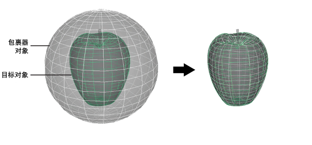

# 收缩包裹变形器

收缩包裹变形器允许您将一个对象投影到另一个对象的曲面。每个收缩包覆变形都包含以下内容：

- 包裹器：变形的对象。

- 目标：包裹器围绕其进行收缩的对象。

 <!-- baize:img-hook downloaded=true reason="正文 228 字 <300 且带图" -->

**注**

如果要使用

“朝向内部对象”(Toward Inner Object)

投影方法，您还需要定义内部对象。请参见

朝向内部对象收缩包裹

。

您可以在许多建模和动画工作流中使用收缩包裹变形器，包括：

- 将附件附加到角色网格

- 重新拓扑网格

- 捕获高分辨率网格的细节

- 蒙皮滑动

**注**

如果在应用了收缩包裹变形后变换或变形目标，则包裹器的形状也会改变。
