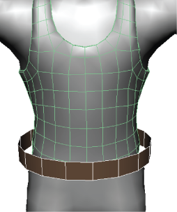
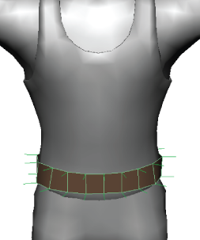

# 沿法线收缩包裹

沿法线收缩包裹

1. 在场景中，选择一个包裹器对象，然后按住 Shift 键并选择目标对象。

   <!-- baize:img-hook downloaded=true reason="正文 270 字 <300 且带图" -->

2. 选择“变形 > (创建)收缩包裹”(Deform > (Create) Shrinkwrap) >  <!-- baize:img-hook downloaded=true reason="正文 270 字 <300 且带图" -->。

3. 在显示的“创建收缩包裹选项”(Create Shrinkwrap Options)窗口中，从“投影”(Projection)下拉列表中选择“顶点法线”(Vertex Normals)。

4. （可选）设置其他创建选项。请参见[收缩包裹选项](../变形器参考/“变形”%28Deform%29菜单/收缩包裹选项%28Shrinkwrap%20Options%29.md)。

5. 单击“创建”(Create)。

  将创建一个“收缩包裹”(shrinkwrap)节点，并且包裹器沿法线收缩包裹。

   <!-- baize:img-hook downloaded=true reason="正文 270 字 <300 且带图" -->

## 相关主题

- [收缩包裹变形器](../收缩包裹变形器.md)

- [编辑收缩包裹变形器](https://help.autodesk.com/cloudhelp/2022/CHS/Maya-CharacterAnimation/files/GUID-FA57BC5A-6BBA-4EC9-8973-C37E13B2D302.htm)
