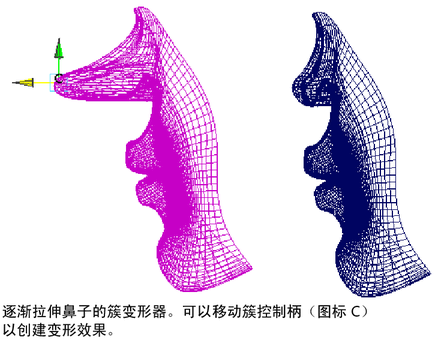

# 簇变形器

如果要在变换期间以不同的数量影响几何体的不同部分，请使用簇。例如，可以为门创建簇，这样，门关上时，中间将稍微弯曲。

使用簇变形器，可以通过改变影响程度来控制对象上的一组点（CV、顶点或晶格点）。变形器将变换应用于点的方式允许您调整每个点受影响的精确百分比。

簇变形器创建一个成员为选定点（CV、顶点或晶格点）的集。可以为每个点指定一个百分比权重，指示您希望每个点受到簇集的任何平移、旋转或缩放的影响程度。当变换簇时，各个点会根据指定的百分比进行相应变换。

 <!-- baize:img-hook downloaded=true reason="正文 225 字 <300 且带图" -->
