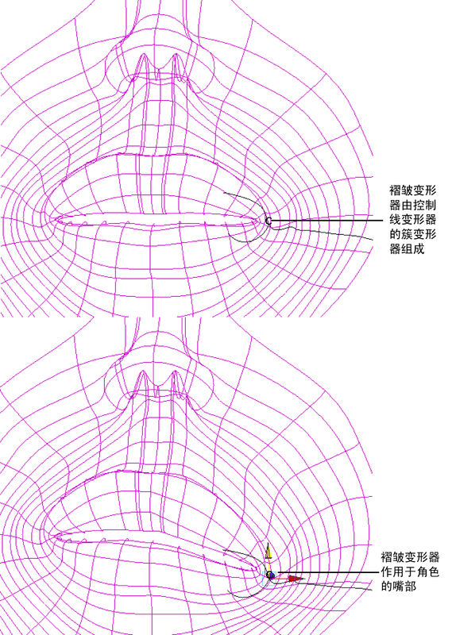

# 褶皱变形器

通过褶皱变形器，可以创建细致的褶皱效果，方法是将线变形器与簇变形器结合使用。

褶皱变形器创建一个线变形器簇。通过控制整簇的线变形器或操纵各个影响线，可以创建变形效果。

由于褶皱变形器是簇变形器和一个或多个线变形器的组合，因此对褶皱变形器设置动画涉及对簇变形器和褶皱变形器的属性设置动画，而不仅是褶皱变形器的属性。

褶皱变形器是簇变形器和一个或多个线变形器的组合。褶皱变形器可用于创建细致的褶皱效果。

 <!-- baize:img-hook downloaded=true reason="正文 255 字 <300 且带图" -->

如果要对单个 NURBS 曲面创建褶皱效果，可以使用三种类型的褶皱变形器：径向褶皱、切向皱褶和自定义皱褶。请参见[褶皱设置](变形器参考/变形器工具/褶皱工具%28Wrinkle%20Tool%29.md#WS17956D7ADBC6E736-6A42F0D5117AE3104C1-7FFC)。
