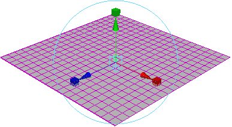
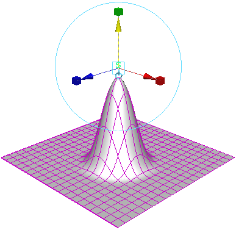
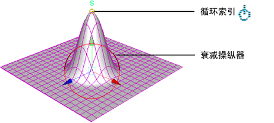
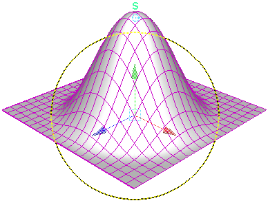
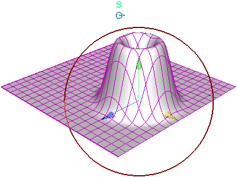

# 示例工作流：使用软修改对曲面变形（带历史）

该示例显示了如何使用“软修改工具”(Soft Modification Tool)交互变形对象。

1. 在“装备”(Rigging)菜单集中，选择“变形 > 软修改”(Deform > Soft Modification)。

2. 单击要修改的曲面的某个部分。

   <!-- baize:img-hook downloaded=true reason="正文 217 字 <300 且带图" -->

3. 移动操纵器以创建变形。

   <!-- baize:img-hook downloaded=true reason="正文 217 字 <300 且带图" -->

4. 单击循环索引以显示衰减操纵器。

   <!-- baize:img-hook downloaded=true reason="正文 217 字 <300 且带图" -->

5. 拖动衰减操纵器圆形以调整衰减半径。

   <!-- baize:img-hook downloaded=true reason="正文 217 字 <300 且带图" -->

6. 调整 [softMod](https://help.autodesk.com/cloudhelp/2022/CHS/Maya-Tech-Docs/Nodes/softMod.html) 节点“衰减曲线”(Falloff Curve)以交互方式调整变形的衰减。

7. 移动衰减操纵器以重新定位变形。

   <!-- baize:img-hook downloaded=true reason="正文 217 字 <300 且带图" -->
