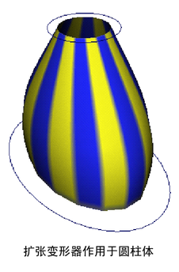
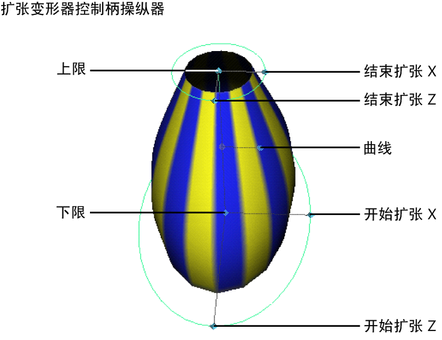

# 扩张变形器

扩张变形器可用于沿着两个轴扩张或锥化任何可变形对象。其可用于角色设置和建模。扩张变形器包括控制柄，控制柄将可用于以直观的方式来控制扩张或锥化效果的范围和曲率。

 <!-- baize:img-hook downloaded=true reason="正文 79 字 <300 且带图" -->

 <!-- baize:img-hook downloaded=true reason="正文 79 字 <300 且带图" -->
