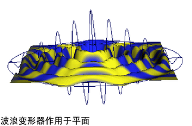

# 波浪变形器

波浪变形器类似于正弦变形器。正弦变形器的正弦波浪按照 X 轴方向的相应振幅在变形器的局部 Y 轴传播。波浪变形器的正弦波浪按照 Y 轴方向的相应振幅沿变形器的局部 X 轴和 Z 轴传播。波浪变形器包括控制柄，可用于以直观的方式控制波浪效果的范围、振幅和波长。

波浪变形器基于圆形正弦波浪变形对象以产生涟漪效果。如果希望立即查看示例，请参见[波浪变形器示例](https://help.autodesk.com/cloudhelp/2022/CHS/Maya-CharacterAnimation/files/GUID-C63D1B86-92C2-49C6-87A7-967F21A054B5.htm)。

 <!-- baize:img-hook downloaded=true reason="正文 177 字 <300 且带图" -->

## 相关主题

- [创建波浪变形器](https://help.autodesk.com/cloudhelp/2022/CHS/Maya-CharacterAnimation/files/GUID-3F0B44FA-DEC3-4EB0-8237-A12722EBDCA9.htm)
