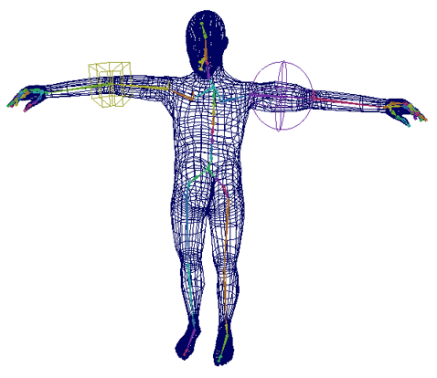

# 屈肌

 <!-- baize:img-hook downloaded=true reason="正文 239 字 <300 且带图" -->

屈肌是设计用于刚性蒙皮的特殊变形器。它们提供各种类型的变形效果，该变形效果可以提高和增强刚性蒙皮提供的效果。Maya 包括五种屈肌类型：

- 关节晶格屈肌提供围绕关节的平滑效果。它们基于晶格变形器。

- 骨骼晶格屈肌提供围绕骨骼的平滑和凸起效果。它们基于晶格变形器。

- 关节雕刻屈肌提供围绕关节的圆化变形效果。它们基于雕刻变形器。

- 骨骼雕刻屈肌提供围绕骨骼的圆化变形效果。它们基于雕刻变形器。

- 关节簇屈肌提供围绕关节的加权变形控制。它们基于簇变形器。

有关创建屈肌的详细信息，请参见[创建所有类型的屈肌](https://help.autodesk.com/cloudhelp/2022/CHS/Maya-CharacterAnimation/files/GUID-E58E7074-521A-485E-85FA-6A1C10CBFA07.htm)。
